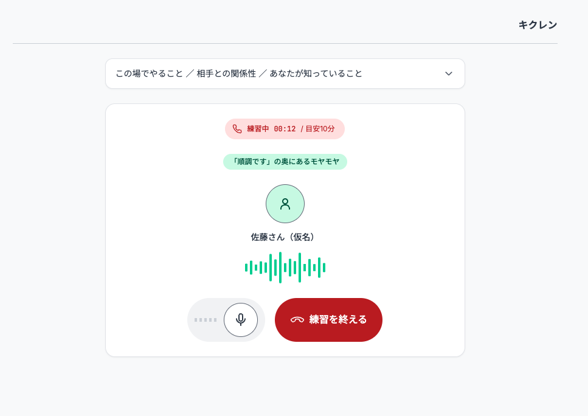

1on1の練習アプリ「キクレン」を共同で制作しています。練習ログはSupabaseのFreeプランに保存しています。

Supabase Freeは、7日間データベースへの活動が少ないと、プロジェクトを自動でpauseします。pause中に練習されると、その回のログは保存できずに消えます。

私たちは、Vercel Cronから6時間ごとに専用テーブルの1行を上書きして、これを防いでいます。追加費用は0円です。何を叩くか、どこから叩くか、止まったらどう気づくかを書きます。

## 作っているもの

キクレンは、マネージャーが1on1の聞き方を音声で練習できるサービスです。ユーザーはマネージャー役として話しかけ、AIは悩みを抱えた部下を演じます。


_練習画面_

https://kikuren.com/?utm_source=zenn&utm_campaign=zenn04

## 課題: pause中の練習ログが消える

公式ドキュメントによると、Freeプランは過去1週間の活動が足りないとpauseされます。目安は「毎日数件のリクエスト」で、復帰はダッシュボードからの手動操作です。

検証の日程が決まっていたうちは、前日に人間が確認して再開すれば足りました。公開して、誰がいつ触るか分からなくなると、それができません。しかもログの書き込みは失敗してもリトライしないので、pause中の練習ログは二度と取れません。

<!-- 要確認(けん) F-1: 実際にpauseして困ったことがあれば1文足す -->

## 何を叩くか

| 案 | 判断 | 理由 |
| --- | --- | --- |
| 画面のURL | 不採用 | 静的配信はDBに触れない |
| ログ保存API | 不採用 | DBには届くが、分析用のテーブルに偽の行が増える |
| 分析用のテーブルを読む | 不採用 | 読み取りだけで足りるとは、公式に書いていない |
| 専用テーブルに1行upsert | 採用 | 確実に書き込みになり、最後に成功した時刻の記録も兼ねる |

読み取りで足りるかを実測する手もありましたが、判定に7日かかり、外れていたらその時点でpauseしています。どちらも1リクエストでコストは同じなので、確実な書き込みにしました。

```sql
create table if not exists db_keepalive_checks (
  source text primary key,
  checked_at timestamptz not null
);
```

`source` が主キーなので、呼ばれるたびに同じ行を上書きし、行は増えません。分析用のテーブルとは結合しません。

## どこから叩くか

候補は、Vercel Cron・GitHub Actionsのschedule・外部のuptime監視・Supabase内部のpg_cronでした。

決め手は、秘密鍵の置き場です。Vercel Cronは自分のAPIを叩くので、Vercelにすでにある接続情報をそのまま使えます。GitHub Actionsや外部サービスから叩くと、Supabaseの秘密鍵をVercelの外へ複製することになります。pg_cronは、DB内部のジョブが「活動」に数えられるかを公式で確認できませんでした。

```json
{
  "crons": [
    { "path": "/api/db-keepalive", "schedule": "0 */6 * * *" }
  ]
}
```

6時間ごとにしたのは、公式の目安が「毎日数件」で、Vercelのcronは取りこぼすこともあると公式に書いてあるからです。なお、VercelのHobbyプランでは、cronは1日1回までです。

## 止まったら、どう気づくか

Vercelは、cronの失敗を再試行も通知もしません。叩く仕組みが止まれば、静かにpauseへ向かいます。そこで、気づく経路を3つ用意しました。

1. DBの `checked_at` が、直近6時間以内かを見る
2. VercelのCron Jobs画面で、実行のログを見る
3. Supabaseからのpauseの事前警告メールを受ける

1つ目を使えるように、APIで2つ工夫しています。

- **cronからの呼び出しと手動の呼び出しで、行を分ける。** Vercel Cronが付ける `x-vercel-cron-schedule` ヘッダがあれば `vercel-cron`、なければ `manual` の行を更新します。同じ行にすると、cronが死んでいても、人間の疎通確認で時刻が進み、動いているように見えてしまいます。
- **`CRON_SECRET` は、登録したときだけ検証する。** 「未登録なら拒否」にすると、登録を忘れただけでkeepaliveが静かに止まります。防ぎたい事故を、防御の側で作らないためです。ただ、未登録だと誰でも `vercel-cron` の行を進められるので、私たちは登録しています。

## 動かして確かめたこと

手動で1回実行し、cronの呼び出しがFirewallに弾かれず、DBへの書き込みが成功する（201）ことを確かめました。ただ、1回目は行の新規作成なので、「上書きされて行が増えない」まではまだ言えません。定刻に走った2回目で、時刻だけが進み、行数が1のままなのを見て確かめました。

「7日間誰も触らなくてもpauseしない」だけは、事前にテストできません。人が触れば、それ自体が活動になるからです。ここは週1回の点検と警告メールに任せています。

<!-- 要確認(けん) F-2: 「稼働から2か月以上、一度もpauseしていない」と書けるなら1文足す。週1回の点検を回していないなら、そう書き換える -->

## Proに上げなかった理由

Supabase Proにすればpauseはなくなりますが、月$25かかります。pauseのためだけには払わず、Proへ移る条件（pauseで検証が遅れた回数など）を決めておくことにしました。

<!-- 要確認(けん) F-4: 金額を出してよいか -->

## 同じことをする人へ

1. 画面のURLを叩いても、Supabaseは起きません。DBに届き、分析用のデータを汚さない書き先を用意する
2. cronをどこに置くかは、「秘密鍵をどこに置くことになるか」で決める
3. Vercel Cronは、失敗を知らせてくれない。cronからの行を分けて、DBを見ればcronの生死が分かるようにする
4. 「7日放置してもpauseしない」は事前に確かめられない。部品ごとに確かめ、残りは運用の点検に任せる

ログは消えてから気づくのがいちばん痛いので、同じ構成で開発している人の参考になればうれしいです。
